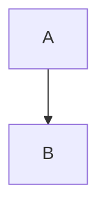
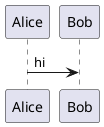

# Every feature

Intro paragraph with a footnote[^1] and a link to https://example.com.

## Setup

Some `inline code` and ~~struck~~ text.

### Details

- [x] done
- [ ] open

## Callouts

> [!NOTE]
> A note with **bold** text.

> [!WARNING] Careful
> Text on the next line.

> [!TIP]

> A plain quote.

## Tables

| Name | Count |
| ---- | ----: |
| b    | 10    |
| a    | 2     |

## Diagrams





## Code

```python
def greet(name: str) -> str:
    return f"hi {name}"
```

```unknownlang
plain text
```

```
no language
```

## Math

Inline $e^{i\pi} + 1 = 0$, but $5 and $200k and SQL `$1` stay text.

$$
\int_0^1 x\,dx = \tfrac12
$$ (eq1)

#### Deep heading

<div>raw html</div>

[^1]: The footnote.
